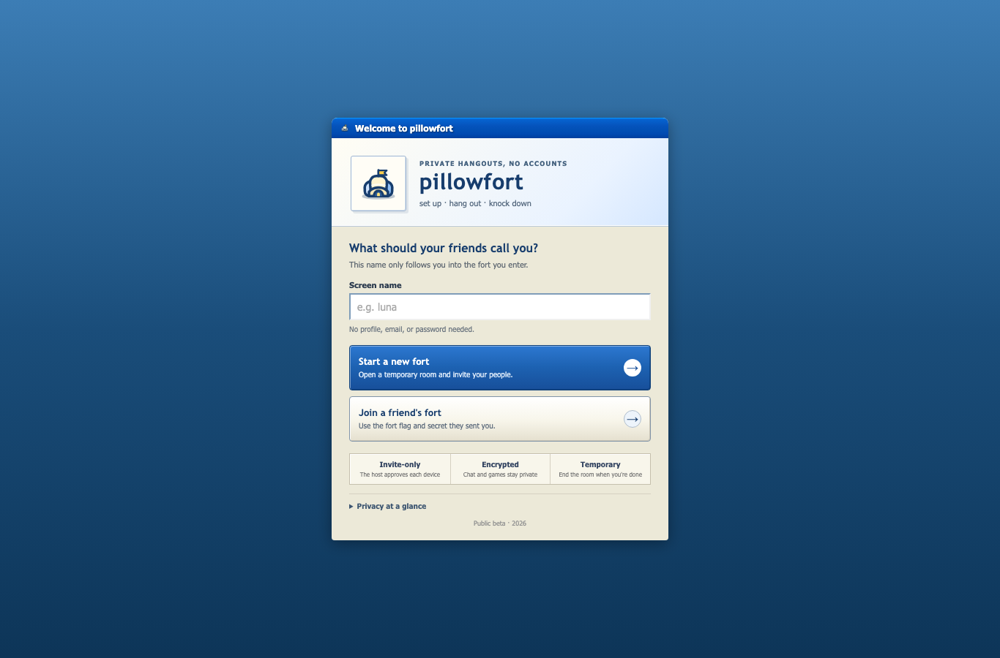
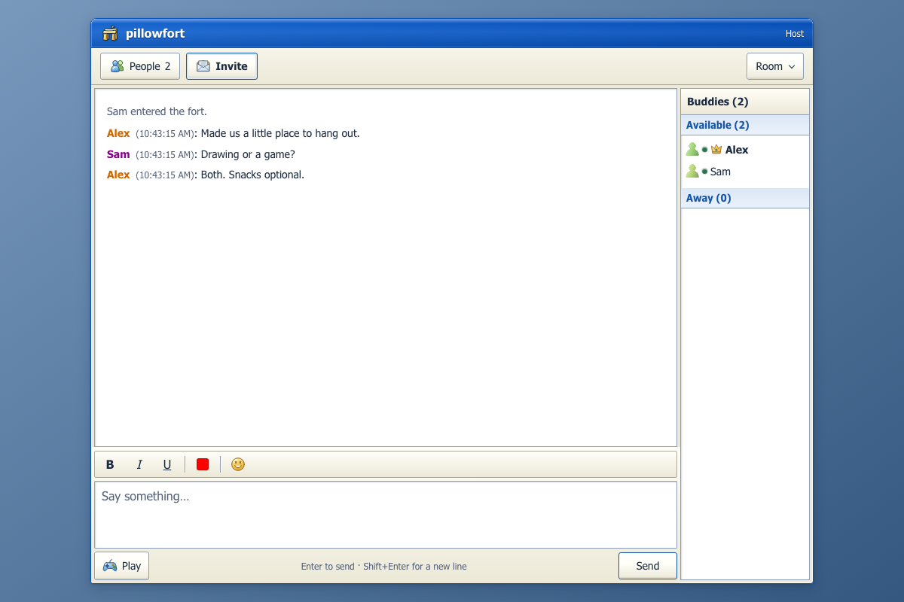

# pillowfort

Small, private, disposable chat rooms with AIM / Windows XP energy.

Set up a fort, share a private invitation link, hang out in real time, then knock it down. No accounts. No public room list.

**[Open Pillowfort](https://pillowfort.xyz)** · [Learn more](https://about.pillowfort.xyz)

<p align="center">
  
  
</p>

## Start a fort

1. Pick a screen name, create a fort, and save the generated room password.
2. Open **Invite**, choose **Copy invite link**, and share it privately.
3. Approve the people you expect to join.
4. Chat, doodle, and play games together.
5. Knock the fort down when you're done, or let it expire.

You can also join with a code and password instead of a link.

## Inside a fort

- Encrypted chat with formatting, @mentions, typing indicators, and away messages.
- A shared sketchpad with colored ink and PNG export.
- Games including Rock Paper Scissors, Tic-Tac-Toe, Secret Saboteur, and King of the Hill.
- Desktop and mobile layouts, plus chat export.
- Optional host-paid Fort Pass for custom codes, longer idle windows, and premium themes.

## Privacy basics

New devices need host approval and do not receive earlier chat or drawings. Keep invitation links private: they contain the room password. A screen name or invitation alone does not prove someone's identity; you can compare device fingerprints over a trusted channel for extra assurance.

Rooms are temporary, not an offline inbox. Participants can save or copy what they receive, so ending a fort does not erase their copies.

## AI agents

Agents can host or join forts, chat, draw, and play through MCP, the SDK, or CLI. They still need host approval and follow room permissions. Hosted agents' runtime and model/operator can access the content shared with them.

See the [agent quickstart](docs/agents/index.md) for setup and the [agent security guide](docs/agents/security.md) for permissions and privacy.

## Run locally

Requires Bun **1.4.4+** and Node.js **22.23.4+**, **24.22.1+**, or **26.12.1+** on a supported release line, plus npm. See [security maintenance](SECURITY.md#security-maintenance).

```bash
npm install
npm --prefix client install
npm run build
npm run dev
```

Open [localhost:3000](http://localhost:3000). Rebuild with `npm run build` after frontend changes.

## Contributing

Run `npm test` for the core tests and `npm run typecheck` for type checks.

See [ARCHITECTURE.md](ARCHITECTURE.md) for the codebase and runtime design. Room behavior runs locally in `server.ts` and in production in `src/room.ts`; changes to room rules usually need both.
